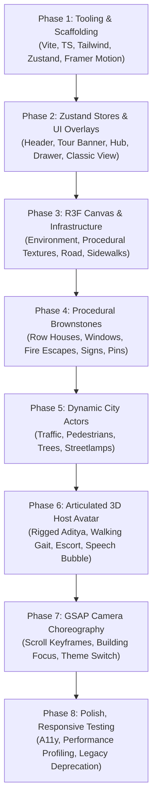

# Migration Plan: Vanilla Three.js Brownstone Portfolio to Vite + React + R3F Stack

> **Status:** All Phases 1–6 Complete & Verified! 🎉  
> **Target Stack:** Vite, React 19, TypeScript (strict), React Three Fiber (R3F v9), `@react-three/drei` (v10), Zustand (v5), Tailwind CSS, GSAP, Framer Motion.  
> **Source Project:** `aditya_gupta_3d_brownstone_city_portfolio.html` (Preserved intact for reference).  
> **Migrated App:** `/app` (Clean build, 0 TypeScript errors, fully verified).

---

## 1. Project Audit

### 1.1 Files & Dependencies
* **Files:** Exactly one monolithic source file: `aditya_gupta_3d_brownstone_city_portfolio.html` (157 KB, 3,128 lines). No `package.json`, build configuration, or bundler exists yet.
* **External CDNs used:**
  * Tailwind CSS (`https://cdn.tailwindcss.com`)
  * Font Awesome 6.5.1 (`https://cdnjs.cloudflare.com/ajax/libs/font-awesome/6.5.1/css/all.min.css`)
  * Google Fonts: *Inter* (body/sans) and *Space Grotesk* (display/headings)
  * Three.js r128 (`https://cdnjs.cloudflare.com/ajax/libs/three.js/r128/three.min.js`) loaded dynamically when 3D mode is enabled.
* **Assets & Textures:** 100% procedural! There are **zero external 3D models (GLTF/GLB)** and **zero external image textures**. Every brick, asphalt street, window, wood, and fabric texture is generated on off-screen HTML5 `<canvas>` elements and converted to `THREE.CanvasTexture`.

---

### 1.2 How the 3D Scene is Built
1. **Renderer & Tone Mapping:**
   * `THREE.WebGLRenderer` with antialiasing enabled, pixel ratio capped at 2 (`Math.min(window.devicePixelRatio, 2)`).
   * Shadows enabled with `THREE.PCFSoftShadowMap`.
   * Tone mapping: `THREE.ACESFilmicToneMapping` with exposure set to 1.0.
   * Dynamic auto-performance scaling: If framerate drops below 40 FPS, shadows and pixel ratio automatically downgrade.
2. **Atmosphere & Lighting:**
   * `THREE.Fog(color, 20, 180)` and `scene.background`.
   * `HemisphereLight` (sky/ground dual tint).
   * `AmbientLight` (warm fill).
   * `DirectionalLight` (Sun) with a `2048x2048` shadow map and orthographic shadow frustum covering `[-120, 120]`.
   * Visible Sun Mesh & Additive Blending Halo Sphere at `[120, 110, -180]`.
   * 24 procedural clouds (clustered spheres) drifting along the X-axis with wrapping boundaries.
3. **Environment & Street Infrastructure:**
   * Infinite green ground plane (`1000x1000`).
   * Foreground lawn (`BoxGeometry`, procedural noise grass texture).
   * Cobblestone promenade / front sidewalk (`BoxGeometry`, procedural paving tile texture).
   * Curbs (`BoxGeometry`, concrete roughness).
   * Asphalt roadway (`BoxGeometry`, procedural asphalt texture) with center dashed lines and 3 zebra crosswalks (at `x = -39, 13, 65`).
   * Back sidewalk and rear curbs.
4. **Procedural Brownstone Row Buildings:**
   * 9 brownstone blocks in total:
     * 2 background filler blocks on the left (`x = -104, -78`).
     * 5 interactive portfolio buildings (`x = -52, -26, 0, 26, 52`).
     * 2 background filler blocks on the right (`x = 78, 104`).
   * Each block features:
     * Double townhouse facade with alternating red, brown, and tan procedural brick textures + bump maps.
     * Architectural details: quoins (corner stone blocks), heavy molded cornices with corbels/brackets, ground-floor storefront bases with pilasters, entrance stoop stairs, and awnings.
     * Bay window column variants and multi-story sash windows with lintels, stone sills, and flower planter boxes.
     * Multi-level cast-iron fire escapes with vertical ladders, railings, and platform grating.
     * Rooftop water towers (timber barrel, iron hoops, conical roof, and steel legs).
     * Custom canvas-generated storefront signs (`1024x192`) displaying building number and title.
     * Storefront interior glow point-lights.
5. **Street Props:**
   * 8+ vintage cast-iron streetlamps with glowing lantern spheres.
   * Fire hydrants and wooden park benches with iron armrests.
   * Stylized procedural trees (tapered trunks, surface root flares, angled branches, and multi-sphere puffed canopies with gentle wind sway).
6. **Animated Scene Actors:**
   * **Pedestrians (24 agents):** Fully articulated procedural humanoid rigs (torso, head, hair, backpack, pivot-jointed arms and legs) strolling along sidewalks and crossing crosswalks with continuous walk cycles.
   * **Vehicles (12 cars):** Sedans, SUVs, and NYC yellow cabs with roof signs, illuminated headlights/taillights, and rolling cylinder wheels cruising along the two street lanes.
   * **Aditya Gupta (3D Host Character):**
     * Custom articulated avatar modeled after Aditya's reference photo: dark patterned denim jacket with acid-wash twill texture and silver buttons/pockets, coral-red graphic tee with "AG" circular emblem, indigo denim jeans, chunky black street boots, styled hair, facial features, and a pulsing golden ground halo.
     * Rigged with hip, pelvis, torso, neck, head, shoulder, elbow, wrist, hip, knee, and ankle pivots.
     * Autonomous escort logic: Smoothly runs/walks along the avenue ahead of the camera, stops at the building storefront when focused, stands on the left at the City Hub, turns to face movement direction or the visitor, and waves enthusiastically.

---

### 1.3 How the Camera & Scroll Mechanics Work
1. **Scroll Track:**
   * A fixed `#canvas-container` sits behind a transparent DOM scroll track (`#scroll-track`) measuring `750vh`.
   * Standard scroll listener computes `scrollProgress = window.scrollY / maxScroll` ($0.0 \to 1.0$).
2. **Camera Path (Spline / Piecewise Interpolation):**
   * Keyframe table with positions and look-at targets:
     * `p = 0.00`: High in the sky above clouds (`pos: [0, 70, 60]`, `look: [0, 60, -20]`).
     * `p = 0.10`: Mid-descent clearing tree line (`pos: [-26, 30, 45]`, `look: [-36, 15, 0]`).
     * `p = 0.20`: Approaching Building 1 (`pos: [-52, 8.2, 28]`, `look: [-52, 8.2, -18]`).
     * `p = 0.28`: Building 1 — 101 About Me (`pos: [-52, 6.2, 18]`, `look: [-52, 7.2, -19]`).
     * `p = 0.44`: Building 2 — 103 Skills (`pos: [-26, 6.2, 18]`, `look: [-26, 7.2, -19]`).
     * `p = 0.58`: Building 3 — 105 Projects (`pos: [0, 6.2, 18]`, `look: [0, 7.2, -19]`).
     * `p = 0.72`: Building 4 — 107 Resume (`pos: [26, 6.2, 18]`, `look: [26, 7.2, -19]`).
     * `p = 0.86`: Building 5 — 109 Contact (`pos: [52, 6.2, 18]`, `look: [52, 7.2, -19]`).
     * `p = 1.00`: City Hub Overview (`pos: [4, 5.5, 36]`, `look: [-6, 3.5, 12]`) — pulled back to frame the entire street and Aditya character.
   * Hermite smoothstep interpolation (`smoothT = localT * localT * (3 - 2 * localT)`) between adjacent keyframes.
   * Smooth camera dampening: `currentCamPos.lerp(desiredPos, 0.035)` with cursor-based parallax offsets (`mouseParallaxX`, `mouseParallaxY`).
3. **Focused Building Camera Mode:**
   * When a building is selected, the camera shifts to an intimate storefront perspective (`targetCamPos: [b.xPos + offset, 4.8, 7.2]`).
   * If the user scrolls by more than 4% while in focus mode, the drawer automatically closes and returns camera control to the scroll path.

---

### 1.4 Guided Tour & Overlays
* **Stage 1: Sky Hero (`progress < 0.11`)**  
  Displays intro badge ("Interactive 3D City Experience"), main title ("I build fast, beautiful 3D web experiences"), subtitle, "Scroll Into The City" CTA, and "Skip to City Hub" CTA. Fades out as scroll descends.
* **Stage 2: Street Tour Banner (`0.22 <= progress <= 0.90`)**  
  Floating glass pill at bottom center indicating the current building number, subtitle ("Aditya's Guided Tour • Place X of 5"), building name, and an "Enter" action button.
* **Stage 3: Destination Hub (`progress > 0.91`)**  
  Side card dock on the right containing quick-jump destination cards for all 5 buildings.
* **3D-to-2D Projected Overlays:**
  * **Roof Pins:** Projected from each building's 3D roof position (`[b.xPos, 21.8, -13.0]`) to screen coordinates using `vector.project(camera)`.
  * **Speech Bubble:** Projected above Aditya's avatar head (`adityaHeadWorldPos.project(camera)`), displaying contextual dialogue ("Hi! I'm Aditya! Where would you like to go?").
  * **Hover Label Tooltip:** Follows cursor when hovering over interactive buildings or Aditya.

---

### 1.5 Side Panels & Modals
* Slide-out glassmorphism drawer (bottom sheet on mobile, slide drawer from the right on desktop, `sm:w-[480px] md:w-[540px]`).
* Contains:
  1. **Building 1 (#101, About Me):** Profile avatar, animated "Open to Work" status indicator, bio, engineering philosophy.
  2. **Building 2 (#103, Skills):** Categorized skill groups (Frontend, 3D Web & Motion, Backend & Cloud, DevOps & Tools) with interactive badges.
  3. **Building 3 (#105, Projects):** Master-detail view. Clicking a project card hides the list and displays the deep-dive view (Challenge, Role, Tech Stack, Result, Live Demo & GitHub Code links) with a back button.
  4. **Building 4 (#107, Resume):** CV download button (generates browser text blob), interactive vertical career timeline with company, role, year, and impact summary.
  5. **Building 5 (#109, Contact):** Client-validated contact form (Name, Email, Message) with loading spinner and success states, plus direct email and social media links.
* Drawer footer includes **Previous**, **Go to Hub**, and **Next** navigation buttons to cycle through buildings sequentially.

---

### 1.6 Theme Switch (Daylight vs. Golden Evening)
* Toggles between Daylight and Golden Hour / Dusk.
* Smoothly lerps:
  * Background color (`0xdbe3ea` $\leftrightarrow$ `0x231d33`)
  * Fog color (`0xdbe3ea` $\leftrightarrow$ `0x231d33`)
  * Hemisphere light (`0xf3f8ff` $\leftrightarrow$ `0x3a334f`)
  * Ambient light (`0xfff5e6` $\leftrightarrow$ `0xff9e6d`)
  * Directional sun light color & intensity (`1.35` $\leftrightarrow$ `1.05`)
  * Window materials: `emissiveIntensity` shifts from `0.0` (day) to `1.0` (evening warm amber glow `0xffa34d`).
  * Streetlamp lanterns light up.
  * Nav bar button updates icon (sun $\leftrightarrow$ moon) and triggers a toast notification.

---

### 1.7 Classic 2D Accessible Mode
* Accessible single-page 2D layout fallback for users with `prefers-reduced-motion`, low device memory (`< 4 GB`), or manual toggle via nav button.
* Bypasses WebGL completely to conserve GPU/battery, rendering structured vertical glass sections with full content.

---

### 1.8 State & External APIs / Keys
* **Current State:** Handled via mutable globals (`scrollProgress`, `focusedBuildingIndex`, `isGoldenHour`, `hoveredBuildingId`, `mobileMenuOpen`) and `localStorage` (`portfolioViewMode`).
* **External APIs & Secrets:** **NONE.** No API keys, no backend database, no third-party cloud services are required. All assets are procedurally generated in the client runtime.

---

## 2. Feature Parity Checklist

The migrated application must preserve 100% of the following capabilities:

| # | Feature Area | Parity Requirement |
|---|---|---|
| **1** | **Hero & Sky Descent** | Cinematic intro fade, sky headline, subtitle, "Scroll Into The City" and "Skip to City Hub" CTAs, smooth camera drop through the clouds down to street level. |
| **2** | **Scroll Choreography** | 750vh scroll track driving smooth Hermite-interpolated camera path from sky descent past 5 distinct buildings down to the street hub overview, with mouse parallax dampening. |
| **3** | **5 Interactive Buildings** | 5 brownstone facades with unique numbers (101, 103, 105, 107, 109), procedural brick bump textures, storefront signs, awnings, stoops, quoins, cornices, bay windows, and water tanks. |
| **4** | **3D Raycasting & Building Hover** | Hovering a building causes a gentle physical lift (`y += 0.65`), subtle scale up, spotlight tracking, cursor pointer change, and floating HTML tooltip. Clicking focuses the building. |
| **5** | **Street Tour Bar** | Synchronized bottom banner appearing between scroll `0.22` and `0.90`, indicating current building count, address, name, and an "Enter" action button. |
| **6** | **Building Interior Drawer** | Slide drawer (responsive bottom-sheet on mobile, right drawer on desktop) with header, dynamic body content, previous/next building stepping, and close action. |
| **7** | **Interactive Drawer Content** | • About: Open to work pulse & bio.<br>• Skills: Tag cloud in 4 categories.<br>• Projects: Master-detail drill down with live & code links.<br>• Resume: Timeline & CV download button.<br>• Contact: Form validation, submission states, and social links. |
| **8** | **Destination Hub** | Side dock appearing at scroll end (`> 0.91`) listing all 5 buildings with click-to-focus triggers. |
| **9** | **Golden Evening Theme Switch** | One-click toggle transitioning the entire environment from crisp daylight to warm dusk with glowing windows and streetlamps. |
| **10** | **3D Street Pedestrians** | 24 articulated walking characters on sidewalks and crosswalks with limb swinging and path wrapping. |
| **11** | **Vehicles / Traffic** | 12 sedans, SUVs, and NYC yellow cabs cruising in opposite lanes with spinning wheels and functioning headlights/taillights. |
| **12** | **Aditya Host Character** | Detailed articulated avatar matching reference outfit (denim jacket, coral tee, jeans, boots), walking ahead of visitor, escorting to storefronts, waving, and displaying a 3D-projected speech bubble. |
| **13** | **Classic 2D View Mode** | Instant toggle between full 3D WebGL and clean accessible single-page 2D layout (with localStorage persistence). |
| **14** | **Toasts & Feedback** | Non-blocking glassmorphic toast notifications for theme changes, resume download, wave trigger, and contact actions. |

---

## 3. Proposed Folder Structure

```
portfolio/
├── index.html
├── package.json
├── tsconfig.json
├── tsconfig.node.json
├── vite.config.ts
├── tailwind.config.js
├── postcss.config.js
├── public/
│   ├── favicon.svg
│   └── og-image.png
└── src/
    ├── main.tsx
    ├── App.tsx
    ├── index.css
    │
    ├── types/
    │   ├── portfolio.ts            # Building, Project, Skill, Experience types
    │   └── scene.ts                # Camera keyframes, Theme, Actor types
    │
    ├── store/
    │   ├── usePortfolioStore.ts    # Focused building, drawer state, active tab
    │   ├── useThemeStore.ts        # Daylight vs. Golden Evening state & colors
    │   ├── useScrollStore.ts       # Normalized scroll progress (0..1)
    │   └── useViewModeStore.ts     # 3D vs. Classic 2D mode with localStorage
    │
    ├── data/
    │   ├── buildingsData.ts        # Data for all 5 buildings (About, Skills, Projects, Resume, Contact)
    │   ├── cameraKeyframes.ts      # Spline keyframe coordinates and look-at targets
    │   └── themeConfig.ts          # Day/Night lighting, fog, and emissive presets
    │
    ├── utils/
    │   ├── proceduralTextures.ts   # Canvas procedural textures (Bricks, Paving, Grass, Asphalt, Windows, Signs, Denim)
    │   └── math.ts                 # Hermite smoothstep, angle lerping, projection helpers
    │
    ├── components/
    │   ├── ui/                     # Pure DOM / Framer Motion Overlays
    │   │   ├── NavigationHeader.tsx# Top brand, quick-jump nav, theme & view toggles
    │   │   ├── MobileMenu.tsx      # Mobile full-screen drawer
    │   │   ├── SkyHeroOverlay.tsx  # Stage 1 sky intro headline & CTAs
    │   │   ├── TourBanner.tsx      # Stage 2 bottom tour banner
    │   │   ├── DestinationHub.tsx  # Stage 3 end-of-street destination card dock
    │   │   ├── BuildingDrawer.tsx  # Building side panel (Framer Motion slide-over)
    │   │   ├── BuildingPanels/     # Content panels rendered inside BuildingDrawer
    │   │   │   ├── AboutPanel.tsx
    │   │   │   ├── SkillsPanel.tsx
    │   │   │   ├── ProjectsPanel.tsx # Master-detail project view
    │   │   │   ├── ResumePanel.tsx   # Timeline + resume generator
    │   │   │   └── ContactPanel.tsx  # Validated contact form
    │   │   ├── Toast.tsx           # Global notification pill
    │   │   ├── HoverTooltip.tsx    # Cursor-following tooltip
    │   │   └── ClassicView.tsx     # Accessible 2D single-page fallback view
    │   │
    │   └── canvas/                 # React Three Fiber 3D Components
    │       ├── CityCanvas.tsx      # Canvas wrapper, camera, suspense, stats, resize handler
    │       ├── CameraController.tsx# GSAP / useFrame scroll camera interpolation & parallax
    │       ├── Environment/
    │       │   ├── SkyAndAtmosphere.tsx # Sun, halo, clouds, fog, dynamic lights
    │       │   └── StreetGround.tsx     # Lawn, sidewalks, curbs, asphalt road, crosswalks
    │       ├── Buildings/
    │       │   ├── BrownstoneRow.tsx    # Spawns 9 row buildings (filler + interactive)
    │       │   ├── BrownstoneBlock.tsx  # Single modular building component
    │       │   ├── FireEscape.tsx       # Cast iron railings, stairs, platforms
    │       │   ├── WaterTower.tsx       # Rooftop wooden water tank
    │       │   └── BuildingPins.tsx     # Drei <Html> or screen-projected roof pins
    │       ├── Props/
    │       │   ├── StreetLamps.tsx      # Vintage lamps with emissive lanterns
    │       │   ├── StreetFurniture.tsx  # Hydrants, park benches
    │       │   └── StylizedTrees.tsx    # Trunks, roots, puffed swaying canopies
    │       ├── Actors/
    │       │   ├── PedestrianGroup.tsx  # Articulated walking pedestrians
    │       │   ├── TrafficGroup.tsx     # Moving cars, cabs, SUVs with spinning wheels
    │       │   └── AdityaCharacter.tsx  # Articulated host avatar (walking, escort, wave)
    │       └── SpeechBubble3D.tsx       # Screen-projected speech bubble over Aditya's head
    │
    └── hooks/
        ├── useScrollProgress.ts    # Synchronizes DOM scroll container with Zustand
        └── useRaycastHover.ts      # Pointer hover detection on interactive buildings
```

---

## 4. Phased Migration Plan

Each phase is designed to be **independently testable and shippable**, allowing continuous verification without breaking existing behavior.



---

### Phase 1: Tooling Scaffolding & Design System Setup
* **Objectives:**
  1. Initialize a clean Vite + React 18/19 + TypeScript project in the workspace.
  2. Install dependencies: `@react-three/fiber`, `@react-three/drei`, `three`, `@types/three`, `zustand`, `tailwindcss`, `postcss`, `autoprefixer`, `gsap`, `framer-motion`, `lucide-react`.
  3. Configure Tailwind CSS with the brownstone design tokens (amber accents, glassmorphic blur, Space Grotesk and Inter fonts).
  4. Keep the legacy HTML file untouched as a benchmark while setting up the modern app structure.
* **Testing & Deliverables:**
  * `npm run dev` boots without TypeScript or lint errors.
  * Verified Tailwind utility classes and glassmorphic card styling.

---

### Phase 2: State Stores & DOM UI Layer (Including Classic 2D Mode)
* **Objectives:**
  1. Define TypeScript models for `BuildingData`, `Project`, `Skill`, `Experience`, and `Theme`.
  2. Implement Zustand stores: `usePortfolioStore`, `useThemeStore`, `useScrollStore`, `useViewModeStore`.
  3. Recreate all DOM UI components with React & Framer Motion:
     * `NavigationHeader`: Brand mark, quick-jump buttons, theme toggle, view mode switch, mobile menu.
     * `SkyHeroOverlay`: Intro headline, call-to-actions.
     * `TourBanner`: Bottom street guide caption banner.
     * `DestinationHub`: Right-hand destination cards.
     * `BuildingDrawer`: Responsive slide drawer with full content for About, Skills, Projects (master-detail), Resume (timeline + text CV download), and Contact (validated form).
     * `Toast`: Reusable notification toast.
     * `ClassicView`: Complete accessible 2D layout.
* **Testing & Deliverables:**
  * Toggle between 3D placeholder and Classic View.
  * In Classic View, all 5 sections, the master-detail project viewer, resume downloader, and contact form operate flawlessly.
  * In 3D placeholder view, opening/closing the drawer, stepping prev/next, and triggering toasts work smoothly.

---

### Phase 3: R3F Canvas Setup, Atmosphere, Lighting & Procedural Grounds
* **Objectives:**
  1. Set up `<Canvas>` in `CityCanvas.tsx` with ACES Filmic tone mapping, PCF soft shadows, and responsive sizing.
  2. Port procedural texture generation utilities (`proceduralTextures.ts`) for bricks, sidewalk pavers, asphalt, and grass.
  3. Build `SkyAndAtmosphere.tsx`: Sun mesh, additive halo sphere, directional sun with shadows, hemisphere light, ambient light, fog, and drifting cloud clusters.
  4. Build `StreetGround.tsx`: Foreground grass lawn, front and rear cobblestone sidewalks, curbs, asphalt roadway with dashed divider, and crosswalk striping.
* **Testing & Deliverables:**
  * Canvas renders at 60 FPS.
  * Sun casts clean soft shadows across the road and sidewalks.
  * Clouds drift smoothly and wrap seamlessly across the horizon.

---

### Phase 4: Procedural Brownstone Row Buildings & Markers
* **Objectives:**
  1. Port `createBrownstoneBlock` into a reusable, declarative R3F component (`BrownstoneBlock.tsx`).
  2. Replicate the modular architectural detailing:
     * Alternating red, brown, and tan brick shaders with procedural bump maps.
     * Corner stone quoins, molded cornices, and corbel brackets.
     * Storefront bases with pilasters, doors, stoop steps, and fabric awnings.
     * Upper sash windows with interior warm window textures, lintels, and planters.
     * Multi-floor cast-iron fire escapes with platforms, railings, and stairs.
     * Rooftop water towers.
  3. Assemble `BrownstoneRow.tsx` placing 2 left filler buildings, 5 interactive buildings, and 2 right filler buildings.
  4. Attach custom store signboards with canvas-rendered text for each portfolio building.
  5. Add floating building pins (using `@react-three/drei`'s `<Html>` or screen projection) linked to building focus actions.
* **Testing & Deliverables:**
  * All 9 brownstone buildings render with crisp architectural details and procedural textures.
  * Building pins float above rooflines and trigger building focus on click.

---

### Phase 5: Dynamic City Actors (Traffic, Pedestrians, Trees & Street Props)
* **Objectives:**
  1. **Street Props (`Props/`):**
     * Vintage streetlamps with glowing lantern meshes.
     * Fire hydrants and wooden park benches.
     * Stylized procedural trees with gentle sinusoidal wind sway in `useFrame`.
  2. **Pedestrian Simulation (`PedestrianGroup.tsx`):**
     * Recreate the 24 articulated walking humanoid meshes (torso, head, hair, backpack, arms, legs).
     * Animate walking gait cycles in `useFrame`, handle sidewalk boundaries and crosswalk crossing.
  3. **Traffic Simulation (`TrafficGroup.tsx`):**
     * Recreate sedans, SUVs, and NYC yellow cabs with taxi roof signs, headlights, and taillights.
     * Animate two-way traffic along the roadway with rotating wheels and boundary wrapping.
* **Testing & Deliverables:**
  * Avenue feels alive with moving vehicles, walking pedestrians, and swaying foliage.
  * No memory leaks or geometry recreation inside the animation loop.

---

### Phase 6: Articulated 3D Host Avatar (Aditya Gupta) & Speech Bubble
* **Objectives:**
  1. Build `AdityaCharacter.tsx` with articulated rig components:
     * Denim jacket with procedural acid-wash texture and silver buttons.
     * Coral-red graphic tee with "AG" chest emblem.
     * Denim jeans, chunky black boots, sculpted hair, and facial features.
     * Pulsing golden contact ring under his feet.
  2. Rig pivots: Hips bob, legs swing with knee articulation, torso rotates, arms swing naturally, right arm waves when active.
  3. Guide choreography:
     * Aditya smoothly walks ahead of the camera along the avenue during scroll.
     * Moves to the storefront stoop when a building is opened.
     * Stands at the left of the screen during the City Hub overview.
     * Rotates smoothly to face movement direction or the visitor.
  4. Implement `SpeechBubble3D.tsx`: Screen-projected speech bubble pinned over Aditya's head with interactive "Say Hi!" wave trigger.
* **Testing & Deliverables:**
  * Character walks smoothly with natural knee/arm articulation.
  * Clicking Aditya triggers his waving animation and toast greeting.
  * Speech bubble projects accurately on mobile and desktop without clipping.

---

### Phase 7: GSAP Camera Choreography, Building Focus & Theme Engine
* **Objectives:**
  1. **Camera Choreography (`CameraController.tsx`):**
     * Bind DOM scroll track to Zustand's `scrollProgress`.
     * Use GSAP or Hermite curve interpolation in `useFrame` across all 9 keyframes (sky $\to$ street $\to$ buildings $\to$ hub).
     * Apply subtle mouse parallax dampening on camera position.
  2. **Interactive Raycasting (`useRaycastHover.ts`):**
     * Pointer move/up detection for buildings: elevates building slightly (`y += 0.65`), scales up (`1.015`), tracks hover spotlight, and opens building on click.
     * Seamless camera transition into storefront closeup when focused.
  3. **Theme Switch Integration (`useThemeStore.ts`):**
     * Smoothly lerp background, fog, ambient/hemisphere/sun lights, and window emissive glow between Daylight and Golden Evening over 1–2 seconds.
* **Testing & Deliverables:**
  * Full scroll descent feels identical or superior to the original vanilla implementation.
  * Clicking buildings or nav buttons smoothly animates camera to storefront.
  * Golden Evening toggle creates an atmospheric dusk glow across all windows and streetlamps.

---

### Phase 8: Polish, Performance Optimization & Legacy Deprecation
* **Objectives:**
  1. **Performance Tuning:**
     * Optimize canvas textures with memoization to ensure zero texture thrashing.
     * Enable frustum culling on all modular building sub-meshes.
     * Verify auto-performance downgrade on low-end hardware.
  2. **Accessibility & Responsive Checks:**
     * Keyboard navigation (`Tab`, `Enter`, `Escape` to close drawers).
     * Full mobile testing (bottom-sheet modal, touch scrolling, portrait camera framing).
  3. **Production Build & Verification:**
     * Run `vite build` and test production bundle.
     * Archive legacy HTML file cleanly to `legacy/` or reference folder.
* **Testing & Deliverables:**
  * Lighthouse score > 90 on performance and accessibility.
  * 60 FPS maintained during continuous scrolling.
  * Clean, production-ready codebase.

---

## 5. Risks & Decisions for User Approval

### 5.1 Technical Risks & Mitigations
1. **Procedural Canvas Textures in React Lifecycle:**
   * *Risk:* If procedural textures are re-instantiated during React re-renders, GPU memory will leak rapidly.
   * *Mitigation:* Generate all canvas textures once inside a dedicated singleton/memoized module (`utils/proceduralTextures.ts`) outside the component render cycle.
2. **Camera Fighting Between GSAP Scroll & Three.js `useFrame`:**
   * *Risk:* Having both GSAP ScrollTrigger and R3F's `useFrame` directly mutate `camera.position` can cause stutter or jitter.
   * *Mitigation:* Let the DOM scroll listener update a single normalized progress value (`scrollProgress: 0..1`) in the Zustand store. R3F's `useFrame` reads that progress value and applies smooth Hermite/lerp math directly to the camera, ensuring silky 60 FPS synchronization.
3. **Screen-Space 3D Projections (Speech Bubble & Roof Pins):**
   * *Risk:* Standard DOM projection using `vector.project(camera)` inside React can lag 1 frame behind Three.js rendering if not updated inside R3F's render tick.
   * *Mitigation:* Use `@react-three/drei`'s battle-tested `<Html center>` component or coordinate the projection matrix updates within `useFrame`.

---

### 5.2 Clarifications & Open Decisions Needed from You

1. **Icons Library:**
   * The current project loads Font Awesome 6.5.1 from CDN (`fa-user-astronaut`, `fa-bolt`, `fa-code-branch`, etc.).
   * *Recommendation:* Switch to **`lucide-react`** for smaller bundle size and native tree-shaking, OR install `@fortawesome/react-fontawesome` if you want exact 1:1 icon matches. Which do you prefer?
2. **Contact Form Backend:**
   * The current form simulates message sending with a 1.5-second `setTimeout`.
   * *Question:* Should we keep this client-side simulation (with a clean hook ready for integration), or would you like to hook it up to a free service like **Formspree**, **EmailJS**, or **Resend** during the migration?
3. **Resume File:**
   * Currently, the resume button dynamically generates and downloads a plain-text file `Aditya_Gupta_Resume.txt` (or opens a URL if provided).
   * *Question:* Do you have an actual PDF resume file to place in `/public/resume.pdf`, or should we retain the auto-generated downloadable CV?
4. **Classic 2D View:**
   * The legacy project has an entire alternate 2D layout for reduced motion / low memory.
   * *Question:* Do you want to keep this accessible 2D toggle in the React app, or focus purely on the 3D brownstone experience? *(Recommended: Keep it, as it provides great accessibility and mobile fallback).*

---

## Next Step
Once you review and approve this migration plan (and provide your preference on the 4 decisions above), we will proceed with **Phase 1: Tooling Scaffolding & Design System Setup**.

